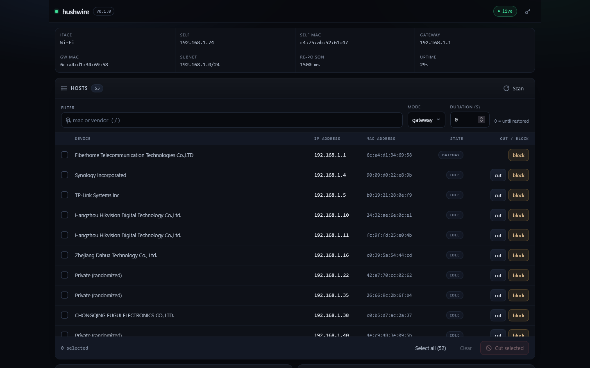
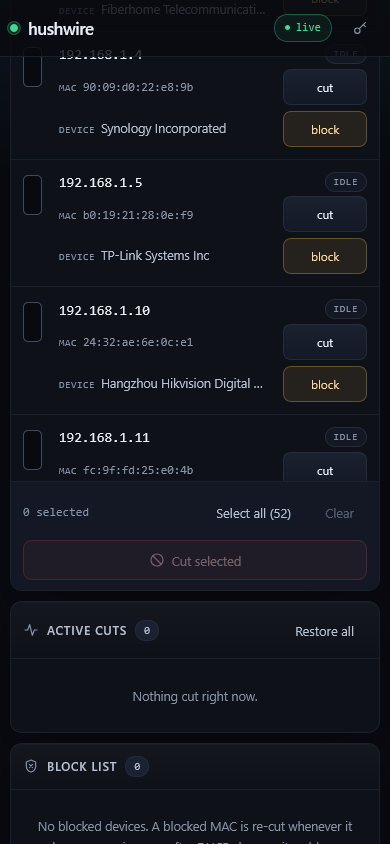

# hushwire

**LAN link control, driven from any browser.**

hushwire is a single Go binary that scans the local subnet, lists every host it
can see, and cuts individual devices off the network by poisoning ARP. The UI is
compiled into the binary, so the agent runs on one machine with L2 access and
everyone else just opens a URL — phone, tablet, or laptop.

It is a network-ops and lab tool: controlled isolation tests, "who is eating the
link" triage, kiosk/guest-device containment. It is not a Wi-Fi deauther and it
does not touch encrypted traffic; it only lies about MAC addresses on the
segment.

<p align="center">
  
</p>

---

## Contents

- [What it does](#what-it-does)
- [How it works](#how-it-works)
- [Features](#features)
- [Platform support](#platform-support)
- [Requirements](#requirements)
- [Build](#build)
- [Quick start](#quick-start)
- [Using the web UI](#using-the-web-ui)
- [CLI reference](#cli-reference)
- [HTTP API](#http-api)
- [Block list and watchdog](#block-list-and-watchdog)
- [Vendor lookup](#vendor-lookup)
- [State file](#state-file)
- [Repository layout](#repository-layout)
- [Troubleshooting](#troubleshooting)
- [Limitations](#limitations)

---

## What it does

| Capability | Detail |
|---|---|
| Discover | ARP sweep of the interface subnet; IP, MAC, vendor, last seen |
| Cut | ARP-poison a device so it loses connectivity |
| Restore | Send corrective ARP replies and drop the cut |
| Block | MAC-keyed watch list; the device is re-cut whenever it reappears |
| Drive remotely | Embedded web UI on the agent, usable from any browser on the LAN |
| Run headless | `-scan` for a one-shot table, `-cut` for a scripted cut with no UI |
| Vendor names | Embedded IEEE registry, offline, ~40k prefixes |

What it is **not**: an IPv6 tool, a Wi-Fi deauthenticator, a switch/AP
management API, or a traffic interceptor. It never forwards or inspects the
target's packets.

## How it works

A cut is a pair of forged ARP replies, re-sent every `-interval` because hosts
age out their ARP caches.

```
gateway mode                       both mode
────────────                       ─────────
gateway: "target IP is at         gateway: "target IP is at
          hushwire MAC"                     hushwire MAC"
                                  target:  "gateway IP is at
target keeps LAN access,                    hushwire MAC"
loses upstream only.
                                  target is isolated at L2
                                  in both directions.
```

`gateway` is the surgical option: the device can still reach other hosts on the
same switch, but nothing beyond the router. `both` is full L2 isolation — the
target cannot reach the gateway *or* its neighbours, because its ARP entry for
the gateway now points at the agent.

Restoring sends the real MAC bindings back, six rounds 150 ms apart, so a poison
frame still in flight cannot win the race.

The agent refuses to cut itself or the gateway, and refuses duplicates. If a
blocked MAC shows up on a new IP (DHCP lease change), the stale cut for the old
address is released and the device is cut again at its new address.

## Features

- **One binary, one file to deploy** — UI (`index.html`, `app.js`, `style.css`)
  is `go:embed`-ed; no CDN, no framework, no asset directory at runtime.
- **Works from a phone** — the layout collapses to cards below 820 px; every
  column gets a visible label so IP/MAC never lose their meaning.
- **Two cut modes** — `gateway` and `both`, selectable per action.
- **Optional auto-expiry** — cut for N seconds, then restore automatically.
- **Persistent block list** — MAC-keyed, JSON-backed, atomic writes, survives
  restarts and DHCP changes.
- **Watchdog** — periodic quiet sweep re-cuts blocked devices; 5 s floor so it
  cannot flood the segment.
- **Live console** — 600-entry ring buffer streamed to the UI over SSE.
- **Token auth** — cookie, header, or `?t=` query (promoted to an HttpOnly
  cookie), constant-time comparison, `no-store` on the UI.
- **Offline vendor lookup** — embedded IEEE MA-L table; external `oui.csv` or
  Wireshark `manuf` can be merged on top.

## Platform support

| Platform | Run the agent | Notes |
|---|---|---|
| Windows 10/11 | yes | Npcap + elevation; MinGW-w64 to build (cgo) |
| Linux | yes | `libpcap-dev` to build; root or `CAP_NET_RAW,CAP_NET_ADMIN` to run |
| macOS | yes | libpcap via Xcode CLT; run as root |
| Android | no | raw L2 sockets require root |
| iOS / iPadOS | no | sandbox forbids raw L2 sockets entirely |

Any device with a browser can *control* the agent regardless of platform. The
table above only constrains where the agent itself can run.

## Requirements

### Windows

1. **Npcap 1.90+** — <https://npcap.com/>. The free edition has no silent
   install; run the GUI installer. Unattended deployment requires the OEM
   edition, and redistribution requires an OEM licence — do not bundle it.
2. **Administrator** — raw ARP sends and Npcap driver access. Some
   WinPcap-compatible installs work unelevated, but do not rely on it.
3. **MinGW-w64** — build only (cgo links against `libpcap`/Npcap). `build.ps1`
   prepends `C:\mingw64\bin` when `gcc` is not on `PATH`.

### Linux / macOS

```sh
# Debian/Ubuntu build deps
sudo apt install libpcap-dev build-essential

# run as root, or grant the capability once:
sudo setcap cap_net_raw,cap_net_admin=eip ./hushwire
```

## Build

`hushwire` uses cgo (`gopacket/pcap` → `libpcap`/Npcap), so **only host builds
are supported out of the box**. Cross-compiling from Windows to Linux/macOS
needs a cross toolchain this repo does not provide.

```powershell
# Windows: stamps version, creates dist\hushwire.exe
.\build.ps1
.\build.ps1 -Version 0.2.0 -Out .\bin
```

```sh
# Linux / macOS
CGO_ENABLED=1 go build -trimpath -ldflags "-s -w -X main.version=0.1.0" -o hushwire .
```

Verify:

```sh
./hushwire -version
```

## Quick start

```powershell
# 1. See what is on the segment (no UI, no cuts)
.\dist\hushwire.exe -scan

# 2. Serve the UI, token-protected, watchdog every 15 s
.\dist\hushwire.exe -token s3cret -watch 15s

# 3. Open the printed URL from any device on the LAN
#    http://192.168.1.10:8080/?t=s3cret
```

The banner tells you exactly what the agent bound to:

```
iface   Wi-Fi
self    192.168.1.10  3c:5a:b4:11:22:33
gateway 192.168.1.1   a4:2b:8c:00:11:22
subnet  192.168.1.0/24

web UI:
  http://127.0.0.1:8080/?t=s3cret
  http://192.168.1.10:8080/?t=s3cret
```

The `?t=` token is absorbed into an HttpOnly cookie and stripped from the
address bar by the UI on first load.

### Headless cut

```powershell
# cut one device for 60 s, then restore automatically
.\dist\hushwire.exe -cut 192.168.1.50 -mode both -duration 60s

# cut several until Ctrl-C
.\dist\hushwire.exe -cut 192.168.1.50,192.168.1.51 -mode gateway
```

`-cut` resolves each IP to a MAC over ARP (2 s timeout), skips invalid or
unreachable addresses, and prints one line per action. `SIGINT`/`SIGTERM`
triggers a full restore before exit.

## Using the web UI

<p align="center">
  
</p>

| Area | What it gives you |
|---|---|
| Status strip | iface, self IP/MAC, gateway IP/MAC, subnet, re-poison interval, uptime |
| Hosts | One row per device: checkbox, Device (vendor), IP address, MAC address, State, Cut/Block |
| Toolbar | Filter, cut mode (`gateway`/`both`), duration in seconds (`0` = until restored) |
| Action bar | Selection count, *Select all* (visible rows), *Clear*, *Cut selected* |
| Active cuts | Per-cut IP, MAC, vendor, mode, packets sent, seconds left, individual restore |
| Block list | MAC, mode, label, vendor, last known IP, added time, *unblock* |
| Console | Live log stream from the agent (SSE), *Clear* only clears your view |

Behavior worth knowing:

- **Scan on load.** The page sweeps automatically with a 3 s timeout; press
  *Scan* to repeat.
- **State polling.** Status every 2 s, block list every 10 s, logs streaming.
- **Filter** matches IP, MAC, and vendor. Press `/` to focus it, `Escape` to
  clear it.
- **Selection survives re-render** and is pruned only for devices that vanished
  from the latest scan; an ordinary refresh keeps your checkboxes.
- **Mode and duration are remembered** in `localStorage` per browser.
- **Row actions** are *Cut* (temporary) and *Block* (persistent + watchdog). The
  gateway and self rows expose only *Block* — the agent refuses to cut either.
- **`[hidden]` is honored globally** (`display:none !important`), so panels that
  do not apply never leak into the layout.
- **Mobile ≤ 820 px** switches the table to cards; the `#hostHead` row is hidden
  and each field carries its own `::before` label.

## CLI reference

All flags come from `main.go`:

| Flag | Default | Meaning |
|---|---|---|
| `-iface` | `""` | Interface name; empty picks the first usable IPv4 interface |
| `-cidr` | `""` | Override the scan subnet, e.g. `192.168.1.0/24` |
| `-oui` | `""` | Optional IEEE `oui.csv` or Wireshark `manuf` merged over the embedded table |
| `-addr` | `:8080` | Listen address for the UI (`:8080` binds all interfaces) |
| `-token` | `""` | Required token for the UI/API; empty means **open on the LAN** |
| `-interval` | `1500ms` | Re-poison period per active cut |
| `-state` | `hushwire-state.json` | Block list file; empty = memory only |
| `-watch` | `20s` | Watchdog sweep period; `0` disables; values `< 5s` are clamped |
| `-scan` | `false` | One-shot scan, print table, exit |
| `-cut` | `""` | Comma-separated IPs to cut headlessly, then hold until exit or `-duration` |
| `-mode` | `gateway` | `gateway` or `both` (headless) |
| `-duration` | `0` | Headless cut duration; `0` = until Ctrl-C |
| `-version` | `false` | Print version and exit |

Notes:

- Flags may be written with one or two dashes (`-token`, `--token`).
- There is no config file; everything is flags plus the state file.
- `-scan` and `-cut` are mutually exclusive in practice — `-scan` returns first.
- `-addr 127.0.0.1:8080` keeps the UI local. The default `:8080` exposes it to
  the LAN, which is the point of the tool — always pair it with `-token` on
  untrusted networks.

## HTTP API

Every endpoint is JSON. Bodies are decoded with `DisallowUnknownFields`, so an
extra key is a `400`, not a silent ignore.

### Auth

When `-token` is set, a request is accepted if **any** of these match:

| Method | Example |
|---|---|
| Cookie | `hushwire_token=<token>` (HttpOnly, SameSite=Lax) |
| Header | `X-Token: <token>` |
| Query | `?t=<token>` — also sets the cookie |

Failure returns `401 {"error":"unauthorized"}`. Comparison is constant-time.

### Endpoints

| Method | Path | Purpose |
|---|---|---|
| `GET` | `/api/status` | iface, selfIp, selfMac, gatewayIp, gatewayMac, cidr, ready, intervalMs, version, uptimeSec, cuts |
| `GET` | `/api/scan?timeout=<sec>` | Sweep; `timeout` defaults to 3 s, capped at 15 s |
| `GET` | `/api/logs` | `{"entries":[{time,level,msg}]}` snapshot |
| `GET` | `/api/events` | SSE stream; replays the tail, 20 s keepalive ping |
| `POST` | `/api/cut` | Start cuts |
| `POST` | `/api/restore` | Stop cuts |
| `GET` | `/api/blocks` | Block list |
| `POST` | `/api/blocks` | Add a block (and cut now) |
| `POST` | `/api/blocks/remove` | Remove a block, restore its cuts |
| `GET` | `/` | Embedded UI |

`/api/scan` returns `devices`, `count`, `selfIp`, `gatewayIp`, `cidr`, and
`autoCut` (cuts started by the block list during that sweep).

### Cut

```http
POST /api/cut
Content-Type: application/json

{"ips":["192.168.1.50"],"mode":"both","duration":60}
```

```json
{"started":[{"ip":"192.168.1.50","mac":"9c:8e:99:0a:1b:2c","vendor":"Dahua",
             "mode":"both","started":"…","expires":"…","secondsLeft":60,
             "packets":0}],
 "skipped":[{"ip":"192.168.1.1","reason":"that is the gateway"}]}
```

- `mode` defaults to `gateway`; `duration` is seconds, `0` or omitted = no expiry.
- The agent rejects its own IP/MAC, the gateway IP/MAC, malformed addresses,
  and duplicate cuts. Rejections land in `skipped` with a reason.

### Restore

```http
POST /api/restore
{"ips":[]}
```

- Empty `ips` → `{"restored":"all"}`.
- Otherwise → `{"restored":["192.168.1.50"],"failed":[{"ip":"…","reason":"…"}]}`.

### Blocks

```http
POST /api/blocks
{"mac":"9c:8e:99:0a:1b:2c","ip":"192.168.1.42","mode":"gateway","label":"lab camera"}
```

```json
{"block":{…},"cut":{…},"cutError":"…(optional)"}
```

- `mac` or `ip` is required; an IP alone is resolved over ARP.
- `label` is free text for the UI; `mode` is stored and used for every re-cut.
- Adding an existing MAC merges into the existing entry instead of duplicating.

```http
POST /api/blocks/remove
{"mac":"9c:8e:99:0a:1b:2c"}
```

```json
{"mac":"9c:8e:99:0a:1b:2c","restored":["192.168.1.42"]}
```

### curl examples

```sh
TOKEN=s3cret

curl -s -H "X-Token: $TOKEN" http://127.0.0.1:8080/api/status
curl -s -H "X-Token: $TOKEN" "http://127.0.0.1:8080/api/scan?timeout=3"
curl -s -H "X-Token: $TOKEN" -H 'Content-Type: application/json' \
     -d '{"ips":["192.168.1.50"],"mode":"both","duration":60}' \
     http://127.0.0.1:8080/api/cut
curl -s -H "X-Token: $TOKEN" -H 'Content-Type: application/json' \
     -d '{"ips":[]}' http://127.0.0.1:8080/api/restore
```

> **PowerShell:** inline JSON through `curl.exe -d` gets mangled by the
> parser. Write the body to a file and pass `--data-binary "@body.json"`, or use
> `Invoke-RestMethod -Body ($obj | ConvertTo-Json)`.

## Block list and watchdog

A block is keyed by **normalized MAC** (lower-case colon form), not by IP, so a
device that changes address is still recognized.

- Adding a block also starts a cut immediately; the response includes
  `cutError` if that particular attempt failed.
- The watchdog sweeps every `-watch` (minimum 5 s) and calls `EnforceBlocks` on
  the result. Any blocked MAC found on the segment is cut again.
- If a blocked MAC appears on a new IP, the old cut is released first; you get
  one cut per device, not one per lease.
- Removing a block stops every cut for that MAC and restores it.
- Blocks persist to the state file after every mutation (atomic replace).

The watchdog is inert until the block list is attached, and an empty list
short-circuits the sweep — a headless run pays nothing for it.

## Vendor lookup

`internal/engine/oui.tsv` holds the IEEE MA-L registry (40,453 prefixes,
~1.2 MB) and is compiled in with `//go:embed`. Lookup works offline with no
external file.

- `Lookup` returns `""` for an unknown prefix.
- A locally-administered MAC (randomized phone/laptop address) returns
  `Private (randomized)`.
- `-oui <path>` merges an external IEEE `oui.csv` or Wireshark `manuf` on top;
  a missing or unparsable file logs a warning and leaves the embedded table in
  place.

To refresh the embedded registry, replace `internal/engine/oui.tsv` with the
same two-column `PREFIX<TAB>ORGANIZATION` shape and rebuild. The binary grows by
roughly the file size (compressed less).

## State file

Default `hushwire-state.json`, next to the working directory:

```json
{
  "blocks": [
    {
      "mac": "9c:8e:99:0a:1b:2c",
      "label": "lab camera",
      "mode": "gateway",
      "added": "2026-11-07T10:12:44.183Z",
      "ip": "192.168.1.42",
      "vendor": "Dahua"
    }
  ]
}
```

- Missing file = empty list; empty file = empty list; malformed JSON is fatal at
  startup (you get the parse error, not a silent reset).
- Invalid MACs in the file are dropped; an unknown `mode` falls back to
  `gateway`.
- Writes go through a temp file and rename, so a crash cannot leave half a file.
- `-state ""` keeps the list in memory only.
- Delete the file while the agent is stopped to start clean.

## Repository layout

```
hushwire-go/
├── main.go                     flags, banner, headless scan/cut, server, watchdog
├── build.ps1                   Windows build (cgo, version stamping)
├── go.mod / go.sum             module hushwire, go 1.27.3
├── internal/
│   ├── api/
│   │   └── server.go           routes, token auth, JSON DTOs, SSE
│   └── engine/
│       ├── engine.go           interface/gateway selection, ARP sweep
│       ├── arp.go              frame encode/decode
│       ├── poison.go           poison/restore frames, modes
│       ├── manager.go          cut lifecycle, watchdog, log ring
│       ├── block.go            MAC-keyed block list, persistence
│       ├── vendor.go           OUI table and lookup
│       ├── oui.tsv             embedded IEEE MA-L registry
│       └── route_*.go          per-OS default-gateway discovery
├── web/
│   ├── index.html              embedded UI
│   ├── app.js                  UI logic, polling, SSE, token handling
│   └── style.css               design system, responsive breakpoints
└── docs/
    └── ui-*.png                screenshots used above
```

Runtime flow:

```
browser ──HTTP/SSE──► api.Server ──► engine.Manager ──► engine.Engine
                                         │                 │
                                    BlockList (JSON)   pcap handle
                                         │                 │
                                    watchdog sweep     ARP frames
```

## Troubleshooting

| Symptom | Cause / fix |
|---|---|
| `open engine: no usable IPv4 interface` | Wrong `-iface`, or the adapter has no IPv4 address. Run `ipconfig` / `ip addr`. |
| `warning: gateway MAC not resolved` | ARP for the gateway failed. Check the subnet, then restart. Cuts cannot work without it. |
| `open \Device\NPF_… for injection: …` | Npcap missing or not permitted. Reinstall Npcap, run elevated. |
| Cuts report success but the device stays online | Wrong mode, or the switch/AP enforces client isolation or static ARP. Try `both`; test a device you control. |
| Scan finds nothing near the expected count | ICMP/ARP filtering, VLAN segmentation, or too-short timeout. Raise `?timeout=` (max 15 s) and verify `-cidr`. |
| `401 unauthorized` in the UI | Token mismatch. Open `http://host:port/?t=<token>` once, or paste it via the key button. |
| UI loads but every call fails | Page was opened from a different origin than the agent, or the token cookie was cleared. Reload with `?t=`. |
| `bad --cidr` at startup | `-cidr` needs CIDR form, e.g. `192.168.1.0/24`, not a bare IP. |
| Watchdog seems slow | `-watch` is clamped to a 5 s floor by design; each sweep walks the subnet. |
| State file parse error on start | Fix or delete `hushwire-state.json`; the agent refuses to guess. |

## Limitations

- **Same L2 segment only.** ARP poisoning cannot cross a router; the target must
  share a broadcast domain with the agent.
- **IPv4 only.** No NDP/IPv6, no proxy-ARP fallback.
- **No Wi-Fi layer attacks.** hushwire does not deauthenticate clients or touch
  the AP's management plane.
- **Client isolation defeats it.** APs and switches that block peer-to-peer
  frames (guest Wi-Fi, many enterprise SSIDs) will not deliver poisoned ARP.
- **Static ARP entries win.** A host with a permanent gateway entry cannot be
  moved.
- **Not stealthy.** Poison frames are visible to any IDS/ARP monitor; expect
  alerts on a monitored network.
- **No traffic interception.** The agent does not enable IP forwarding or read
  the target's payloads; the target simply loses connectivity.
- **Host builds only.** cgo means no easy cross-compilation from Windows.

---

Run this only on networks you own or are explicitly authorized to test. ARP
poisoning is disruptive by design: cutting the wrong MAC can take a production
device offline.
